WebGPU Forward+ and Clustered Deferred Shading
======================

**University of Pennsylvania, CIS 565: GPU Programming and Architecture, Project 4**

* Logan Dooley
  * [LinkedIn](https://www.linkedin.com/in/logan-dooley-a205a619a/)
* Tested on: Google Chrome 155.0.8059.40, Windows 11, AMD Ryzen 7 9800X3D, 32GB RAM, NVIDIA GeForce RTX 5060 Ti 16GB

### Live Demo

**[Open the live demo here](https://logandooley.github.io/Project4-WebGPU-Forward-Plus-and-Clustered-Deferred/)** (requires a WebGPU-capable browser such as Chrome)

[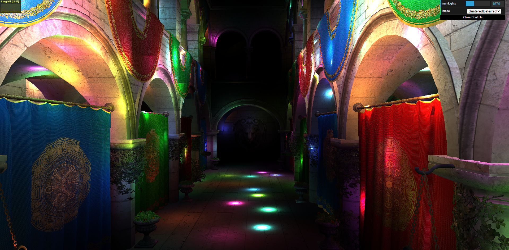](https://logandooley.github.io/Project4-WebGPU-Forward-Plus-and-Clustered-Deferred/)

### Demo GIF

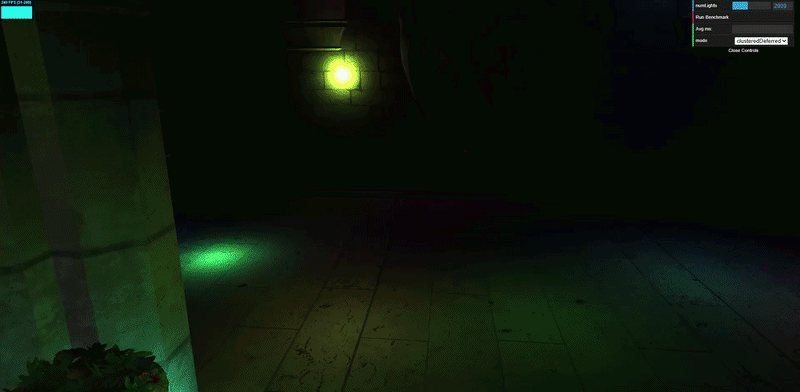
*Clustered Deferred, 2000 Moving Point Lights*

## Overview
This project is a realtime WebGPU-based application which renders the Sponza scene with thousands of moving point lights. It compares implementations of Naive, Forward+, and Clustered Deferred rendering methods. At 5000 point lights, Clustered Deferred is roughly 78x faster than the Naive approach, and 3.57x faster than Forward+.

### Features
- **Naive Renderer:** Every fragment loops over every light
- **Forward+ Renderer:** 
  - 16 x 9 x 24 light clusters using logarithmic depth slicing
  - Compute shader assigns lights to clusters using sphere-AABB test
  - Fragments shade only based on lights in their cluster
- **Clustered Deferred Renderer:** 
  - G-buffer pass to record position, normal, and albedo
  - Fullscreen lighting pass only shading fragments based on lights in their cluster, each screen pixel is only shaded once
- **Benchmark Tool:** WebGPU timestamp query-based benchmark tool with an in-app "Run Benchmark" button

## Table of Contents

* [Renderers](#renderers)
  * [Naive](#naive)
  * [Forward+](#forward)
    * [Clustering Implementation Details](#clustering-implementation-details)
    * [Clustering Visualization](#clustering-visualization)
  * [Clustered Deferred](#clustered-deferred)
    * [G-Buffer Implementation Details](#g-buffer-implementation-details)
    * [G-Buffer Visualization](#g-buffer-visualization)
* [Performance Analysis](#performance-analysis)
  * [Test Setup](#test-setup)
  * [Forward+ vs. Clustered Deferred](#forward-vs-clustered-deferred)
    * [Is one faster?](#is-one-faster)
    * [Is one better at certain types of workloads?](#is-one-better-at-certain-types-of-workloads)
    * [Benefits and tradeoffs of using one vs. the other?](#benefits-and-tradeoffs-of-using-one-vs-the-other)
    * [Reason for performance differences?](#reason-for-performance-differences)
  * [Misc. Optimizations](#misc-optimizations)
    * [Pointer vs. Copy](#pointer-vs-copy)
* [Credits](#credits)

## Renderers

### Naive
The naive renderer's structure is as follows:
- For each mesh in the scene, run a vertex + fragment shader
  - For each fragment
    - For each light in the scene
      - Sum the light contribution to the fragment

The benefits of this method are that it is relatively simple to set up. There is little overhead to getting the data to the shaders that is needed. 

However, for many lights, this nested loop can be a performance bottleneck especially when some lights are nowhere near a given fragment.

| Number of Lights | Frame Time (ms) |
|:-:|:-:|
| 100 | 6.32 |
| 250 | 16.02 |
| 500 | 32.08 |
| 1000 | 65.86 |
| 2000 | 129.75 |
| 3000 | 196.86 |
| 4000 | 260.70 |
| 5000 | 321.23 |

### Forward+
A forward+ renderer is similar to Naive, except it considers only calculating light contributions for lights that are actually close to the fragments it is shading. The rough outline is:
- Split the view space into clusters
- For each cluster
  - Assign the lights that intersect with it

- For each mesh, run a vertex + fragment shader
  - For each fragment
    - Calculate which cluster it is in
    - For each light in that cluster
      - Sum the light contribution to the fragment

The benefits of this method are that unlike Naive rendering, we do not blindly try to calculate light contributions between every light and every fragment. Instead, we only have to calculate light contributions from lights that are nearby a given fragment, thanks to the clustering step. 

The downsides are mainly in clustering overhead and overdraw. The clustering step is a whole extra shader pass that has to happen each frame prior to the normal rendering steps from the Naive method. In terms of overdraw, the issue with forward rendering in general is that the full lighting calculations will be done for a fragment, even if it is overwritten by a closer fragment from a closer mesh later in the loop.

Another downside with both Forward+ and Clustered Deferred methods is that the clusters can only hold a fixed number of lights. Once the number of lights in a cluster surpasses this cap, there are visible seams in the render.

| Number of Lights | Frame Time (ms) |
|:-:|:-:|
| 100 | 0.88 |
| 250 | 1.60 |
| 500 | 2.29 |
| 1000 | 5.15 |
| 2000 | 8.83 |
| 3000 | 11.87 |
| 4000 | 13.79 |
| 5000 | 14.71 |

#### Clustering Implementation Details
For my implementation I used a fixed number of clusters in X, Y, and Z dimensions. In X and Y there are 16 and 9 clusters respectively, evenly distributed across the screen. In Z, there are 24 clusters, which are logarithmically distributed with depth. The equation I used for the logarithmic distribution comes from [this article](https://www.aortiz.me/2018/12/21/CG.html#part-2) and is as follows:
$$Z = Near_z(\frac{Far_z}{Near_z})^{slice/numSlices}$$

$$slice_z = \lfloor \log{(Z)} \frac{numSlices}{\log{Far_z/Near_z}} - \frac{numSlices \times \log{(Near_z)}}{\log{(Far_z / Near_z)}} \rfloor$$

I used a maximum number of lights per cluster of 256. Since the cluster struct stores a number of lights + the light array, this means there are 257 u32s per cluster, so 1028 bytes / cluster. With 16 * 9 * 24 = 3456 total clusters, this leads to 3.553 MB for cluster storage.

Lights are assigned to clusters by a compute shader with one thread per cluster that runs prior to the render passes. For each cluster, the screen position and depth range is converted into view space using the camera's invProjMat to form an AABB. This AABB is then checked against each light in the scene via a Sphere-AABB test to determine if the light could contribute to any fragment in that cluster. Lights are added until either there are no more lights, or if the max cap of 256 lights per cluster is reached.

#### Clustering Visualization
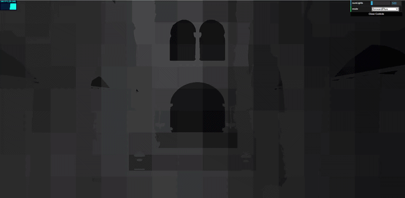
*Heatmap of number of lights per cluster. White: >= 256 lights, Black: = 0 lights*

### Clustered Deferred
A clustered deferred renderer acts similarly to a forward+ renderer, except it does its shading in a deferred manner, only shading each pixel on screen a single time. The rough outline is:
- Split the view space into clusters
- For each cluster
  - Assign the lights that intersect with it

- For each mesh, run a vertex + fragment shader
  - For each fragment
    - Write its position, normal, and albedo into G-Buffers

- Render a fullscreen quad
  - For each pixel
    - Calculate which cluster it is in based on the G-Buffer info
    - For each light in that cluster
      - Sum the light contribution to the pixel

The benefits of this method are that unlike in Forward+, when a fragment is occluded by another fragment on a later mesh, we do not waste time re-computing the lighting contributions to the fragment, since we limit ourselves to one fragment per-pixel. We still do overwrite G-Buffer data when closer fragments are encountered, but the lighting pass which is typically the most expensive is "deferred" until the G-Buffer has been completely finished.

The downsides are that the addition of G-Buffers means there is extra memory cost, as well as deferred rendering not being able to handle transparency very well.

| Number of Lights | Frame Time (ms) |
|:-:|:-:|
| 100 | 0.86 |
| 250 | 0.94 |
| 500 | 1.69 |
| 1000 | 1.93 |
| 2000 | 3.45 |
| 3000 | 3.86 |
| 4000 | 4.05 |
| 5000 | 4.12 |

#### G-Buffer Implementation Details
Without any optimizations, I used the following G-Buffer formats:

| G-Buffer | Format | Bytes / Pixel | Memory Size (1920 x 945) |
|:-:|:-:|:-:|:-:
| Position | rgba16float | 8 | 14.52 MB |
| Normal | rgba16float | 8 | 14.52 MB |
| Albedo | rgba8unorm | 4 | 7.258 MB |

For a total of 36.29 MB

#### G-Buffer Visualization

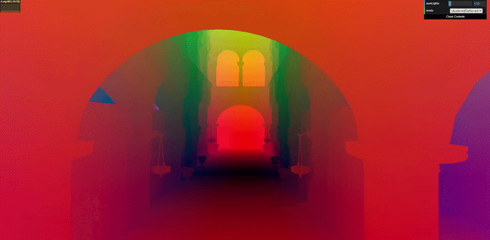
*G-Buffer WorldPos under the equation $abs(worldPos)/10$*

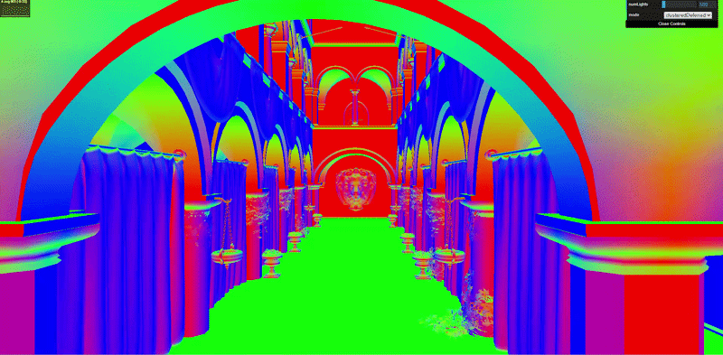
*G-Buffer Normal under the equation $abs(normal)$*

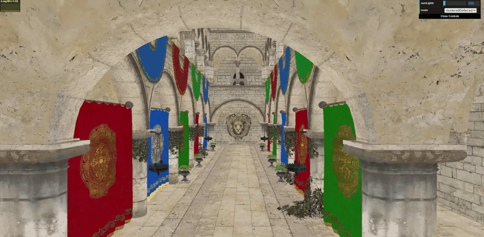
*G-Buffer Albedo*

## Performance Analysis

### Test Setup
- Resolution: 1920 x 945
- VSync: On (Monitor: 240 Hz). This does not affect profiling given the use of timestamp queries to profile actual GPU time.
- Camera Position: Default starting view
- Sampling: Frame time in MS. Taken using timestamp queries in WebGPU. First 20 frames are taken as warmup, and the next 100 are taken as actual frames to be sampled, of which the average is returned. This only includes the render passes GPU time.

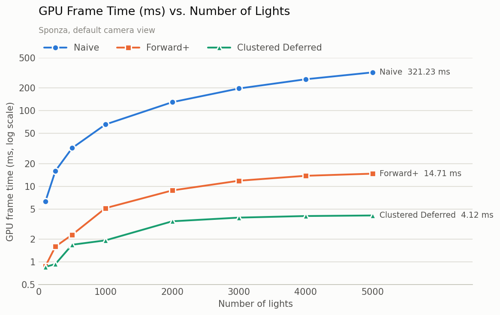
*Ms per frame compared between all 3 renderers for the Sponza scene w/ default camera view*

### Forward+ vs. Clustered Deferred

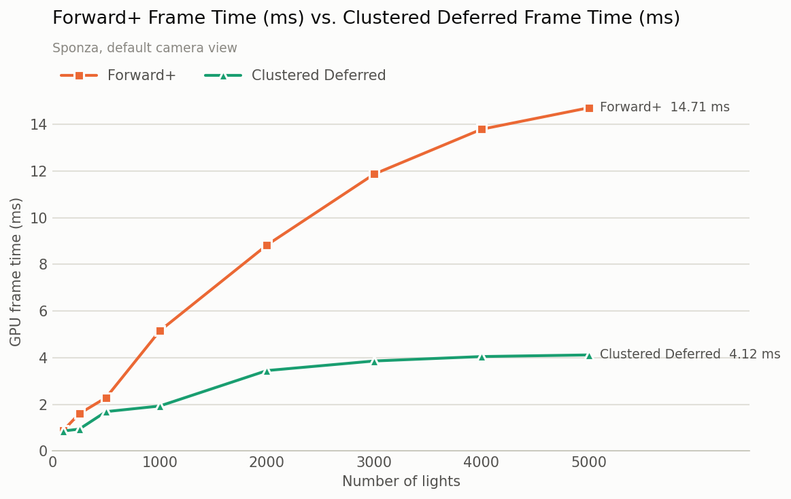
*Ms per frame compared between Forward+ and Clustered Deferred for the Sponza scene w/ default camera view*

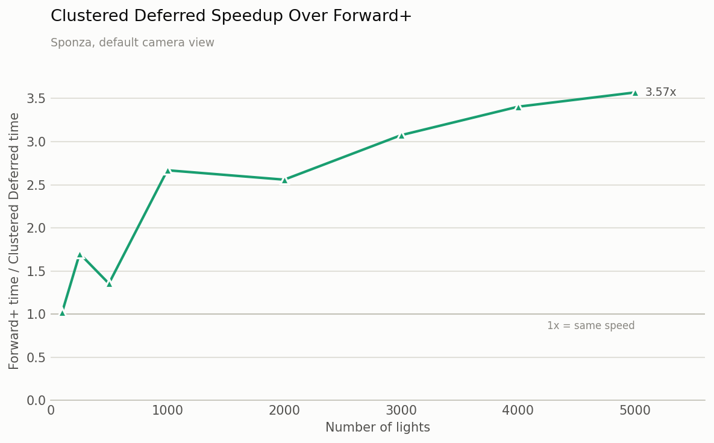
*Frame time speedup of Clustered Deferred over Forward+ for the Sponza scene w/ default camera view*

#### Is one faster?

In all of the cases I tested for numbers of lights between 100 and 5000, clustered deferred was faster for all of them. The speedup of Clustered Deferred over Forward+ also increased with the number of lights, starting from being mostly identical, to a 3.57x speedup at 5000 lights over Forward+.

#### Is one better at certain types of workloads?

Forward+ rendering is generally better for scenes with less overdraw and not as many lights, where the cost of adding a G-Buffer pass and additional memory is greater than re-computing the light calculations occasionally.

Clustered Deferred rendering is generally better with scenes with lots of overdraw and many lights or complex fragment shaders. This is because the fragment shader will only run once per pixel in the final output image, reducing wasted cycles executing the expensive fragment shader on fragments that will be overdrawn by closer ones.

#### Benefits and tradeoffs of using one vs. the other?

For forward+, the biggest advantage over clustered deferred is its lack of a G-Buffer pass. This saves on VRAM as well as makes the implementation overall simpler. It can also handle transparency if the scene is rendered back to front, which deferred rendering cannot do. The downside is that it re-computes lighting for overdrawn fragments, which can waste time.

For clustered deferred, the biggest benefit is that the fragment shading time is independent of the scene complexity, and is instead proportional to the screen size. The downside however is needing to use additional VRAM for the G-Buffers, as well as the implementation being a bit more complex, involving a G-Buffer pass prior to the actual shading pass. It also cannot handle transparency very well.

#### Reason for performance differences?
From the performance tests, seeing the speedup of Clustered Deferred over Forward+ grow is likely due to primarily the reduced overdraw. With 5000 lights, most clusters are likely at maximum capacity in terms of lights per cluster, so the fragment shader is increasingly expensive as the number of lights increases. Only having to run the fragment shader once per final screen pixel in Clustered Deferred over for every fragment regardless of overdraw in Forward+ is likely the biggest reason for the improvement.

From the following heatmaps, we can see that indeed the clusters do become saturated and quite similar at 4000 and 5000 lights in the scene:

| Lights per Cluster @ 4000 Lights | Lights per Cluster @ 5000 Lights | 
|:-:|:-:|
| 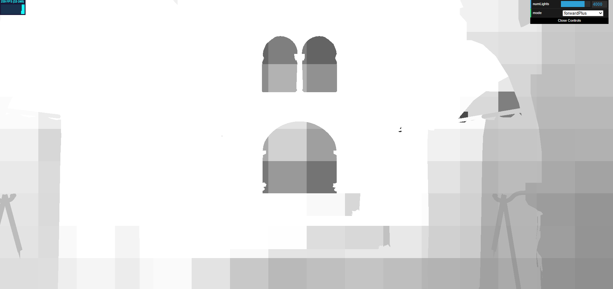 | 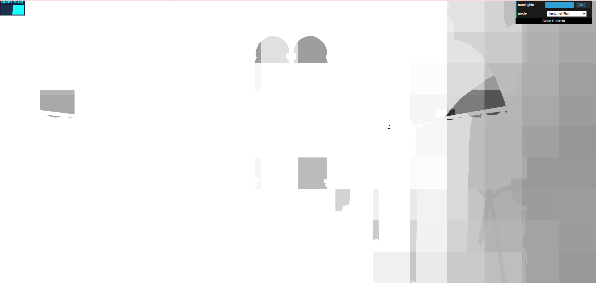 |

*Heatmap of number of lights per cluster. White: >= 256 lights, Black: = 0 lights*

### Misc. Optimizations

#### Pointer vs. Copy
One fundamental optimization I made was accessing light indices in the clusters by pointer as opposed to copying the entire cluster into the fragment shader. Prior to making this change, this is the comparison of the frame times before and after:

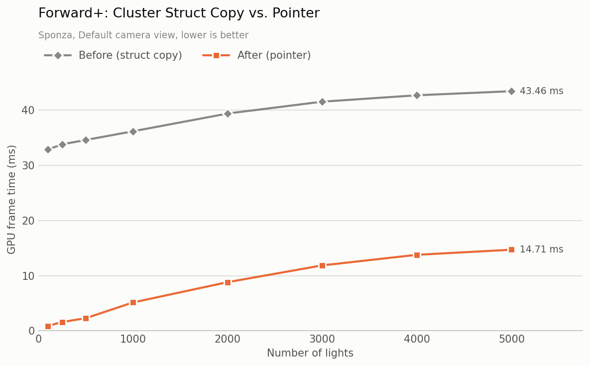
*Forward+ ms per frame for Sponza, default camera view w/ Copy vs. w/ Pointer*

As it is shown, the copy version roughly adds a constant 30 ms to the frame time. This makes sense that the additional time does not scale with light count since we are copying the same amount of data regardless of if there are 0 lights in the cluster or 256.

## Credits
- [Cluster Slicing](https://www.aortiz.me/2018/12/21/CG.html#part-2)
- [WebGPU Timestamp Queries Tutorial](https://webgpufundamentals.org/webgpu/lessons/webgpu-timing.html)
- [Vite](https://vitejs.dev/)
- [loaders.gl](https://loaders.gl/)
- [dat.GUI](https://github.com/dataarts/dat.gui)
- [stats.js](https://github.com/mrdoob/stats.js)
- [wgpu-matrix](https://github.com/greggman/wgpu-matrix)
